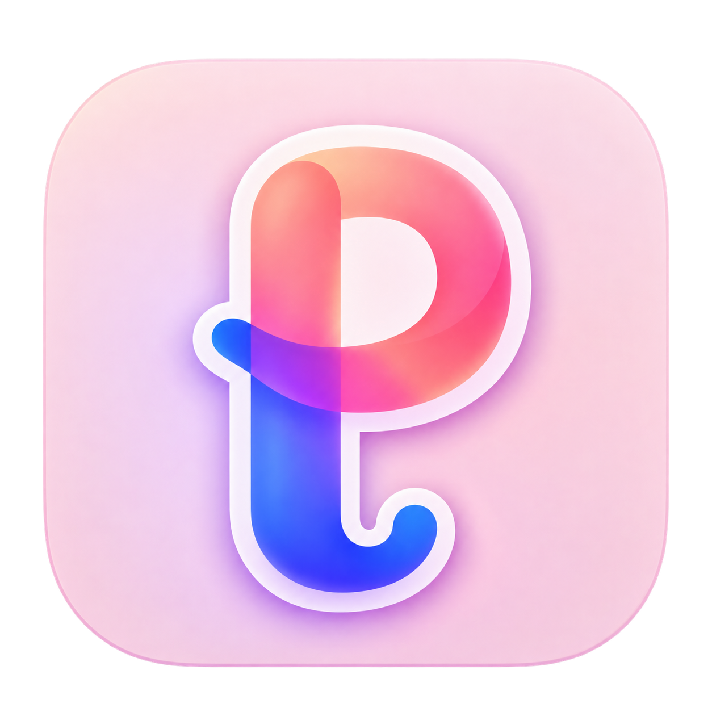
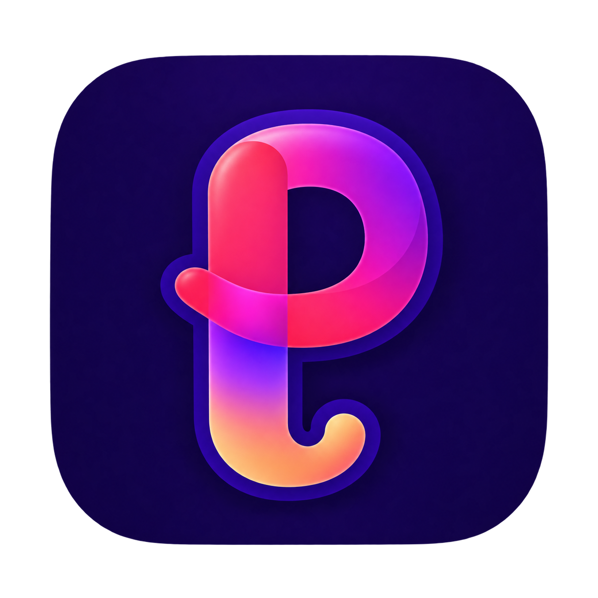
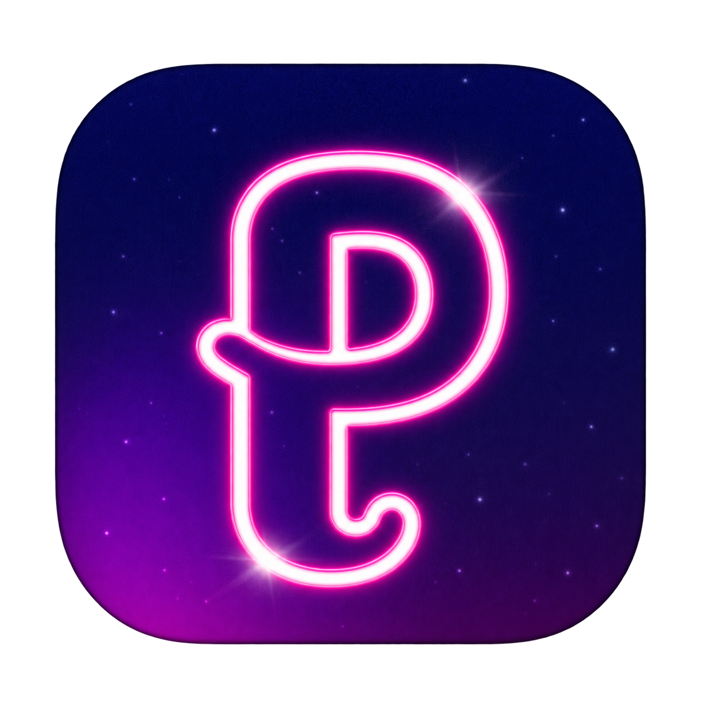
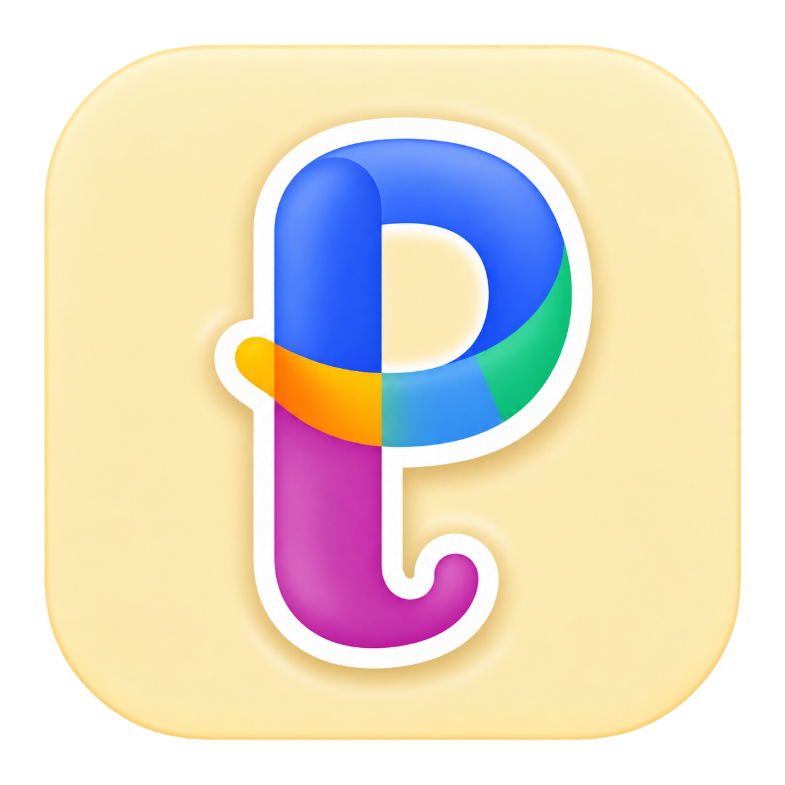
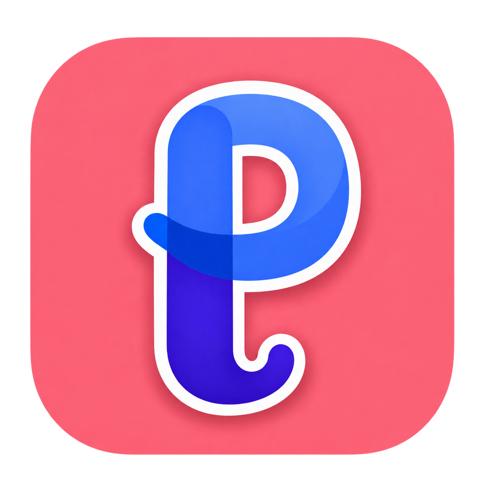

# Parc application icons

`Original.png` is the user-approved master: a rounded P with a small left-facing terminal at the bowl crossing, a long slimmer stem, and an open inward curl turning right at the bottom. Preserve that geometry when adapting other Parc branding. The earlier outward-curl and straight-stem designs are not the selected design.

`catalog.json` selects **Original for every build configuration**, including development and release. `Dev.png` is an optional terminal mascot; its filename does not make it the development default. The mascot has a numeral 1 on the left, a winking eyelid on the right, and a small Parc P on its pedestal.

| Original | Candy | Colorful | Fluted Glass | Hologram |
|---|---|---|---|---|
|  |  |  |  |  |

| Neon | Schoolbook | Early Birds | Canary | Terminal |
|---|---|---|---|---|
|  |  |  |  |  |

## Provenance


The approved deterministic processing preserves
the artwork. The masters now have their outer alpha debris removed while every
RGB byte and every pixel with alpha at least 128 remains identical to the approved
input. `artwork-provenance.json` records the preservation fingerprints. The
source-owned `scripts/derive_app_icon_marks.py` maintenance tool also extracts
`Marks/Borderless.png` from Original's colored P and derives
`Marks/Monochrome.png` with the identical alpha. These are UI marks, not extra
selectable Dock icons. The borderless mark is used by welcome/import branding;
the monochrome mark is tinted by the actual portrait-export compositor. Their
geometry, provenance and checks are in [UI marks](../../docs/app-icon-marks.md).

## Packaging and verification

`scripts/app_icons.py` converts **each of the ten variants** into ten macOS icon representations, then packages one `AppIcons/<Variant>.icns` per variant with Apple's `iconutil`. It copies `Original.icns` to the bundle's `Parc.icns`; `scripts/build.py` declares that default through `CFBundleIconFile` for both debug and release.


| Logical size | 1× pixels | 2× pixels |
|---|---|---|
| 16 pt | 16 × 16 | 32 × 32 |
| 32 pt | 32 × 32 | 64 × 64 |
| 128 pt | 128 × 128 | 256 × 256 |
| 256 pt | 256 × 256 | 512 × 512 |
| 512 pt | 512 × 512 | 1024 × 1024 |

That is **100 representations per build configuration**. The repository tracks the full-resolution artwork, catalog and exporter; resized PNG intermediates are temporary and generated ICNS files stay in ignored app-bundle output. The export applies deterministic optical framing to the approved artwork without redrawing it.

The focused packaging tests execute resource copying, native icon-renderer compilation/export, plist writing, `iconutil`, and round-trip size verification for all ten variants in both configurations. They verify all 200 representations, unchanged source artwork, distinct variant exports, identical per-variant bytes across configurations and Original as the default. Application compiler, engine and signing calls are substituted only in that isolated packaging test. Run with Python 3.11 or newer:

```sh
PYTHONDONTWRITEBYTECODE=1 python3 -m unittest discover -s tests/AppIcons -v
```

The independent-engine packager retains this shared catalog/default and icon packaging contract.

## Optical framing and small sizes

The native exporter measures each master's opaque body and uniformly fits it to
the retained reference envelope: 824/1024 for the nine tiles; 204/256 with a
slightly lower center for Dev. Every size is rendered directly from the master
with native software Lanczos downsampling in sRGB. Pixel-aligned placement and
a transparent outer guard pixel keep small representations consistent without
changing their P geometry, proportions, color or mascot identity. Source PNGs
remain byte-identical throughout packaging.

All 100 representations pass size, visible-bounds, centering and transparency
checks. Actual 16-, 32-, 64- and 128-pixel light/dark comparisons were inspected
for all ten variants. Inert native checks confirm that equal pixel-size ICNS
representations composite identically and reach the same picker/live identity
consumer. [Optical contract and evidence](../../docs/app-icon-optical.md).

## App identity consumers

The ten variants are selectable in Icon Settings, persisted atomically and
restored by the application and its source-owned Dock plugin. Original remains
the default in every configuration. Current selection and native identity
behavior is documented in [Settings](../../docs/settings.md#app-icon), and
included availability in [app icon availability](../../docs/app-icon-availability.md).

[UI marks and alpha cleanup](../../docs/app-icon-marks.md) records ICON08's
source-preservation boundary and actual consumers. The approved variants retain
their individual proportion/shading differences within the common optical frame.
The [icon guide](../../docs/app-icon-picker.md) describes current interaction
and validation boundaries. Integrated Dock/Finder appearance remains part of the separate
whole-product polish pass; these asset checks do not claim a browser runtime test.
